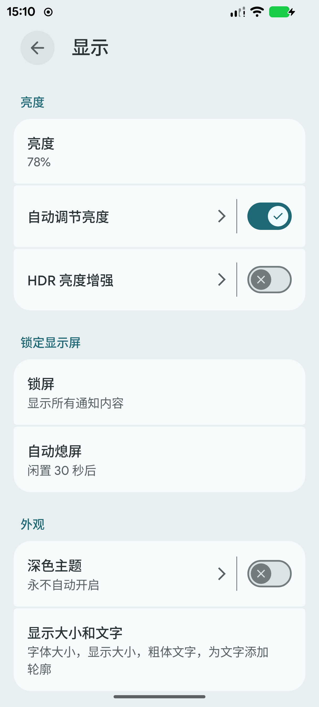
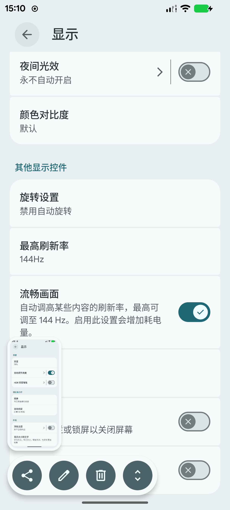
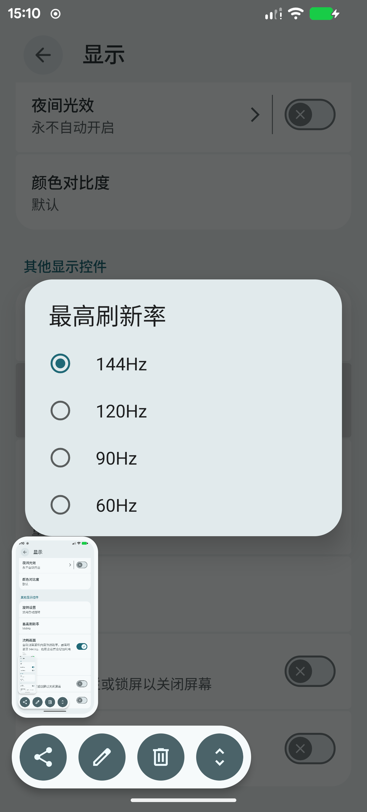
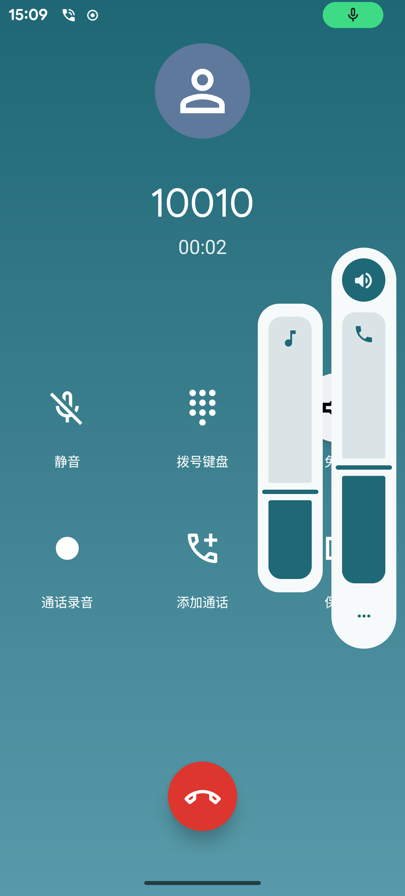
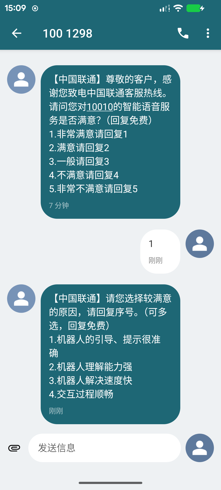
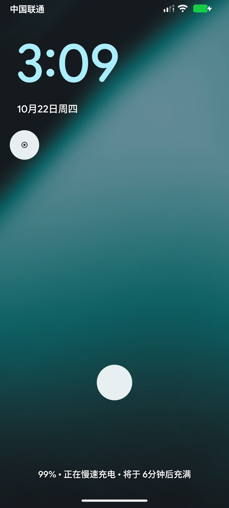

**中文** · [English](#english)

# 红魔 10S Pro+（nubia NX789J）LineageOS 23.2 —— system 侧混合移植

> 从零开始把 **LineageOS 23.2（Android 16）** 移植到 **红魔 10S Pro+ / RedMagic 10S Pro+**（代号 `NX789J`，部分渠道代号 `NX789S`，SoC 高通 SM8750 "sun"）。
>
> **方案：混合（hybrid）。** 只把 `system`、`system_ext`、`product` 三个分区换成 LineageOS 编译产物，原厂 RedMagicOS 的 `vendor`、`odm`、`vendor_dlkm`、`system_dlkm`、内核与 boot 链全部保留。这不是偷懒 —— 原厂固件本身就是这么做的（Android 16 的 system 配 Android 15 的 GRF 冻结 vendor）。

## 作者

| 角色 | 谁 |
|---|---|
| **主要实现：编译、移植、调试、文档** | **DeepSeek 编码 agent** —— 模型 `deepseek-v4-pro`，运行于 DeepSeek Harness（DSH）。本仓库里的 device tree 改动、`patches/` 全部 6 个补丁、`tools/` 全部脚本、`fpbridge/` 桥接 App，以及 `docs/` 全部文档，都由它编写、编译并在真机上验证 |
| 设备提供、真机操作、测试与验收 | VicLFF（[@VicLFF](https://github.com/VicLFF)） |
| 上游 device tree 起点 | [IronShing/android_device_nubia_NX789J](https://github.com/IronShing/android_device_nubia_NX789J)（`lineage-23.2`） |
| 方法论参考 | [DrakiSama/android_device_nubia_nx733j](https://github.com/DrakiSama/android_device_nubia_nx733j)、LineageOS `device/oneplus/sm8750-common` |

### 致谢与来源（必读）

| 谁 | 提供了什么 | 本仓库如何对待 |
|---|---|---|
| **施（QQ 2233209163）** | 红魔 10S Pro+ 的 **澎湃 OS（HyperOS）移植包**。本机现在的 boot 链（`init_boot` / `vendor_boot` / `dtbo` / `vbmeta` / `vbmeta_system`）与 `vendor` / `odm` 分区来自这个包 | **只作为本机自用底包，仓库里不含它的任何文件**；三个 LineageOS 镜像全部由 LineageOS 源码 + ZTE 官方备份里的文件编译，见 [`docs/16-基线审计`](docs/16-基线审计-2026-10-22.md)。感谢他把这台机器救活，并实测证明指纹 / 人脸 / 通话在硬件层是好的 |
| **酷安 @某贼** | **ZTE 工具箱（ZTEToolBox）** —— 官方全分区备份与 EDL 整机恢复工具 | [`docs/17-从底包刷入LineageOS`](docs/17-从底包刷入LineageOS.md) 的备份与恢复流程依赖它；本仓库只调用它，不再分发它 |
| [IronShing](https://github.com/IronShing/android_device_nubia_NX789J) | 上游 device tree（hybrid 方案的起点） | 以补丁形式记录全部改动 |

---

## 实机截图

> 全部来自红魔 10S Pro+（NX789J），系统为 LineageOS 23.2（`23.2-20261020-UNOFFICIAL-NX789J`），底包为官方 RedMagicOS 11.0.14。

<table>
  <tr>
    <td align="center" width="33%"><br><sub><b>显示设置</b><br>「自动调节亮度」已出现并可用</sub></td>
    <td align="center" width="33%"><br><sub><b>最高刷新率</b><br>144Hz + 「流畅画面」开关</sub></td>
    <td align="center" width="33%"><br><sub><b>四档可切</b><br>60 / 90 / 120 / 144 Hz</sub></td>
  </tr>
  <tr>
    <td align="center"><br><sub><b>通话</b><br>VoNR 建立，听筒 / 免提 / 麦克风正常</sub></td>
    <td align="center"><br><sub><b>短信</b><br>收发正常</sub></td>
    <td align="center"><br><sub><b>锁屏</b><br>指纹图标为空白圆（已知问题）</sub></td>
  </tr>
</table>

## 完成度

| | 功能 | 状态 |
|---|---|---|
| ✅ | 开机、系统、桌面、设置 | 正常 |
| ✅ | **通话（VoNR）、麦克风、听筒、扬声器** | 正常 —— 需要一处框架修复，见 `patches/0005-*` |
| ✅ | 短信收发 | 正常 |
| ✅ | 移动数据（5G SA，双卡识别） | 正常 |
| ✅ | Wi-Fi、蓝牙 | 正常 |
| ✅ | 相机（前后共 2 个设备） | 正常 |
| ✅ | 37 个硬件传感器 | 全部正常 |
| ✅ | 显示：60 / 90 / 120 / 144 Hz 可调 | 正常 |
| ✅ | 自动亮度（光感已接入 DisplayPowerController） | 正常 |
| ✅ | LiveDisplay、夜间光效、颜色对比度 | 正常 |
| ❌ | **屏下指纹** | **不可用** —— 见「已知问题」 |
| ❌ | 人脸解锁 | 未移植（原厂与移植包都是私有栈实现，无 AOSP 等价物） |
| ❌ | 内置风扇（涡轮散热） | 不可用 —— 由原厂私有系统服务控制 |
| ❌ | 游戏肩键 | 不可用 |
| ❌ | 后盖氛围灯 | 不可用 |
| ⚠️ | 供电分离（旁路供电） | 未测试 |

验证环境：RedMagicOS 11 官方底包（`nubia/NX789J/NX789J:16/BQ2A.250705.001-BP2A.250605.031.A3`，vendor `:15`，vendor 安全补丁 `2026-05-01`），Bootloader 已解锁。

---

## 测试范围（重要，先看这个）

**本移植只在下面两个官方底包上真机跑通过，其它一律没验证过。**

| 底包 | 版本标识 | 实测结论 |
|---|---|---|
| RedMagicOS **11.0.14** | `nubia/NX789J/NX789J:16/BQ2A.250705.001-BP2A.250605.031.A3/20260813.164726`，vendor 安全补丁 `2026-06-01`，`ro.vendor.product.ztemodel=NX789S_V2A` | **2026-10-22 全流程实测通过**：EDL 刷 OrangeFox → 卡刷 → 清 data → 开机。SIM/通话/移动数据/刷新率/自动亮度/37 个传感器/Wi-Fi 全部正常 |
| RedMagicOS **11.0.13** | 早前的官方全分区备份 | 更早的版本在它之上跑通过。注意：它的 `vbmeta_system` 回滚索引（`1772323200`）低于 11.0.14（`1782864000`），机器记住 11.0.14 之后**刷不回 11.0.13** |

**其它任何底包都没测过**，包括但不限于：别的官方版本、第三方做的移植底包、OTA 之后没清数据的混合状态、以及各种「官方底包 + 别人改过的 vendor」组合。

你要在这些上面试，属于**自测，风险自负**。具体风险：

- **卡刷包会主动拦你**。它内置底包校验（`system ≥ 7000 MB`、`system_ext ≥ 2000 MB`、`product ≥ 900 MB`），不达标直接 abort。这是提醒你底包不对，**不要绕过**——绕过的结果就是「亮 logo 反复重启」。
- **`vendor_boot` 必须跟着底包版本走**。换个底包就用 `tools/vb_repack.py` 拿**你自己那份** `vendor_boot_a.img` 重新生成一次。用错版本最常见的结果是起不来或触摸失灵。
- **底包里的 vendor HAL 决定功能完整度**。本移植只在系统的 `system`/`system_ext`/`product` 三个分区上做文章，`vendor`/`odm`/`vendor_dlkm`/`system_dlkm` 以及 boot 链全部沿用底包。底包不同，能用的功能就可能不同。
- **回滚只能靠自己的官方全分区备份**。没有备份就去试，砖了就是砖了（还有 EDL 兜底，但那也得有正确的整机镜像）。

## 关于「现成的刷机包」

**本仓库只放脚本、补丁和文档，不放任何现成镜像。**

不是偷懒，是不能放：可用的刷机包里必须带一份改过 `first_stage_ramdisk/fstab.qcom` 的 `vendor_boot`，那是中兴的厂商二进制；`system` 镜像里也还带着从官方固件提取的高通 IMS 应用和 ZTE 指纹应用。把这些发出来等于分发厂商固件，与本仓库「只含自有成果」的定位冲突。

所以给的是**可复现路径**，全部在 `tools/` 里：

```bash
# 0) 从自己手机的官方固件包里取 vendor_boot_a.img，然后生成「去 avb」版本
python tools/vb_unpack.py  vendor_boot_a.img ramdisk/          # 看 fstab.qcom 原文
python tools/vb_repack.py  vendor_boot_a.img vendor_boot_noverity.img
#    自动删掉 fstab 中 system/system_ext/product 三条的 avb= 与 avb_keys=

# 1) 卡刷包（橙狐/TWRP 内安装，自带官方底包校验）
python tools/build_cardzip.py

# 2) EDL 线刷包（不挑底包容量，含 vendor_boot 两槽 + 清 data 头）
python tools/build_edl_pack.py \
    --images <三个 system 镜像 + vendor_boot_noverity.img 所在目录> \
    --super-head <自己底包的 super 前 512KB> \
    --out LOS-EDL.zip --zip-store

# 3) 刷之前先空跑检查
powershell -File tools/flash_official_to_los.ps1 -Check
```

补充：`tools/build_edl_pack.py` 里的 `vendor_boot_a/b`、`userdata`、`metadata` 偏移是 NX789J 的 GPT 常量；`system/system_ext/product` 的偏移每次都从你给的 super 头现算，所以换底包不用改脚本。

完整流程见 [`docs/17-从底包刷入LineageOS.md`](docs/17-从底包刷入LineageOS.md)。

## 原理（为什么只能这么做）

vendor 分区里带着约 280 个内核模块和 HAL，全部是按内核 `6.6.92-android15` 编译的。重编内核技术上可行，但随后必须把每一个 vendor 模块同批重编（vermagic / CRC / CFI 都要对上），那已经不是「device tree 移植」的量级。所以本移植**不碰**：

- `boot`、`init_boot`、`vendor_boot`（只改 vendor_boot **ramdisk 里的一个文件**，见下）
- `dtbo`、`recovery`、`vbmeta`、`vbmeta_system`
- 全部 vendor 侧分区

只产出三张逻辑镜像，写进动态分区 `super` 里。

### 唯一一处 boot 链改动：`first_stage_ramdisk/fstab.qcom`

原厂 `vendor_boot` 的 ramdisk 会让 first-stage init 用 `vbmeta_system` 对 `system`、`system_ext`、`product` 做 dm-verity 校验。刷任何 LineageOS 镜像都过不了校验，结果是**在 USB 初始化之前就重启** —— 没有 adb、没有 fastboot，看起来就是无限重启。

`tools/vb_repack.py` 会解包原厂 `vendor_boot`，把这三个条目里的 `,avb=vbmeta_system` / `,avb=vbmeta` / `avb_keys=...` 去掉，重新打包，然后你**只需要刷一次** `vendor_boot_a`（用到 `_b` 就两个槽都刷），走 EDL。

`vbmeta` 本身**永远不要刷**。它的回滚索引和签名链必须保持出厂状态。

---

## 仓库结构

```
patches/                  补丁系列，打在上游设备树之上
  0001-build-config-and-props.patch        BoardConfig.mk / device.mk / system.prop / Android.bp
  0002-overlays-udfps-display-ims.patch    资源 overlay（指纹几何、刷新率、自动亮度、IMS 包）
  0003-audio-vendor-extension.patch        qti.audio.core AIDL + 辅助源码
  0004-sepolicy-and-usr-idc.patch          seapp_contexts + uinput-goodix idc/keylayout
  0005-libaudiohal-vendor-parameter-fallback.patch   frameworks/av —— 通话无声的修复
  0006-systemui-udfps-displaymode-hbm.patch         frameworks/base —— 指纹屏下补光
tools/                    分析与刷机工具（每个文件头有说明，另见 tools/README.md）
fpbridge/                 调试指纹栈时用的小 APK 源码
docs/                     移植过程的工程记录（中文，含《17-从底包刷入LineageOS》刷机流程）
proprietary/              你需要自己提取的原厂文件清单 —— 本仓库不含任何私有文件
```

**本仓库不包含任何原厂二进制文件。** 见 `proprietary/README.md`。

---

## 编译

```bash
repo init -u https://github.com/LineageOS/android.git -b lineage-23.2
repo sync -c -j8

# 上游设备树（本移植是它之上的一组补丁）
git clone https://github.com/IronShing/android_device_nubia_NX789J -b lineage-23.2 \
    device/nubia/NX789J

cd device/nubia/NX789J
git am /path/to/patches/000[1-4]-*.patch

cd ../../..
patch -p1 -d frameworks/av   < /path/to/patches/0005-libaudiohal-vendor-parameter-fallback.patch
patch -p1 -d frameworks/base < /path/to/patches/0006-systemui-udfps-displaymode-hbm.patch

source build/envsetup.sh
lunch lineage_NX789J-bp4a-userdebug
m -j$(nproc) systemimage systemextimage productimage
```

产物：`out/target/product/NX789J/{system,system_ext,product}.img`。

`device.mk` 里部分 `PRODUCT_PACKAGES` 指向需要你自己放置的文件（见 `proprietary/README.md`），否则编译会报模块缺失。

---

## 刷入

本机 bootloader 的 `fastboot` 是**写不进去的**（`Writing 'x' FAILED (remote: 'unknown command')`），可靠通道是 EDL。`fastbootd`（userspace fastboot）对逻辑分区是可写的：

```bash
adb reboot fastboot                      # 必须看到 is-userspace: yes
fastboot flash system     system.simg    # 用 img2simg 转 sparse
fastboot flash system_ext system_ext.simg
fastboot flash product    product.simg
fastboot reboot
```

`tools/edl_flash.ps1` 走的是 EDL（Sahara + firehose），开发全程用的就是它 —— 需要 NX789J 服务包里的 firehose loader。

**除非你完全清楚在做什么，否则不要刷 `vbmeta`、`boot`、`init_boot`、`dtbo`。**

换 ROM 后首次开机会停在 `recovery: init_user0_failed` → 选「恢复出厂设置」（`/data` 的 FBE 密钥随系统变了）。

### 回滚

至少保留：

| 东西 | 从哪来 | 为什么 |
|---|---|---|
| `super` 里的 `system_a`/`system_ext_a`/`product_a` | 刷之前从自己手机 `dd` 出来 | 随时还原 |
| `vbmeta.img`、`vbmeta_system.img` | 同上 | 保险 |
| 完整服务固件 + firehose | 官方/售后包 | 救砖 |

只要手上有 EDL 和原厂 `super.img`，你离一台能用的手机永远只有 60 秒。

---

## 补丁在做什么

- **0001** 把 QTI IMS 组件、`uinput-goodix` 的 idc/keylayout、音频扩展源码、权限白名单加进设备树；同时打开 `BUILD_BROKEN_ELF_PREBUILT_PRODUCT_COPY_FILES := true`（中兴 IMS APK 自带预编译 `.so`，只能复制不能编译）。
- **0002** overlay 了四个 framework/Settings 开关，以及指纹几何 `config_udfps_sensor_props = 608, 2024, 94`（取自 `ro.vendor.feature.fingerprint_sensorui_position_center_*`）。
- **0003 + 0005** 是通话修复。高通音频 HAL 需要 `call_state` / `vsid` / `call_type` 这些**厂商参数**；AOSP 的 `libaudiohal` 在找不到 `IHalAdapterVendorExtension` 服务时会把它们**静默丢弃**（`mVendorExt` 包装器永远非空，只是返回空结果）。补丁加了一层兜底，本地构造这些参数，用一份 `qti.audio.core.VString` 的副本（**包名必须一致**，见 0003）。没有它，voice stream 永远不启动：电话能接通，两边都没有声音。
- **0006** 在 SystemUI 启停指纹会话时往 `/proc/driver/lcd_hbm` 写 `1`/`0` —— 这正是中兴自己的 `FingerprintSensorUi_ZTE` 干的事。

---

## 已知问题

### 屏下指纹不可用

vendor 侧图像链路是断的：

```
E [gdix_tsa][ParseFramedata]: uwFrameIndex error, start:N, end:N+1
E [gdix_tsa][TsaProcessingFrame]: Framedata process fail...
E [gdix_tsa][UpdateFrameMissingFlag]: Missing frame, curFrameIdx(N+1), lastFrameIdx(N-1)
```

`libgdix_tsa.so` 读 14 字节帧头，对前 12 字节算校验和，与偏移 `0xc` 处的 16 位字段比较。两者永远不相等，于是每一帧都被丢弃，Goodix HAL 拿不到任何图像。

这一层之上的所有环节都已经被打通（证据链见 `docs/15-指纹结论-2026-10-22.md`）：

- 中兴用户态栈（`com.fingerprint.sensorservice`）已安装且能收到触摸，
- 屏下补光通道（`/proc/driver/lcd_hbm`）会亮，
- HAL 被成功调用，传感器确实在出帧。

把校验改成 `nop`（`.so` 偏移 `0x7c5bc`）没有用，而且会让**整块触摸失灵** —— 同一批帧里也载着触摸数据，这反过来证明帧数据本身是坏的，而不是校验误报。已回滚，`vendor` 上没有任何改动。

根因是内核 THP 驱动与 TSA 库之间的私有约定，两边都在 `vendor`，只能靠配套的中兴触摸/TSA 固件解决，system 侧无解。

### 人脸解锁

未移植：原厂实现是厂商私有栈（`MiuiGxzw*`、`libmisurfaceflinger`），AOSP 里没有对应实现。

### 风扇、肩键、氛围灯

这三样在原厂都靠**私有系统服务**驱动，AOSP 侧没有对应实现，所以在这套「只换 system 侧」的移植里都不工作：

- **内置风扇**：转速由红魔的散热 / 游戏空间服务控制，没有公开 HAL，也没有 sysfs 通用接口；
- **肩键**：硬件会作为输入设备注册，但映射与触发逻辑在厂商的按键服务里；
- **氛围灯**：走厂商自己的灯效服务，与 AOSP 的通知灯（notification LED）无关。

硬件本身没有坏，切回原厂系统就恢复。请不要把这套系统的「游戏功能」当成可用。

### 供电分离（未测试）

「供电分离 / 旁路供电」这类游戏供电模式**没有测过**：它依赖厂商的充电服务与私有接口，在 LineageOS 上行为未知。把它记作「未验证」，不要当成「能用」。

### 其他

- `adb root` 默认关闭；因为构建是 `userdebug`，`settings put global adb_root 1` + `setprop service.adb.root 1` + `adb root` 可用。
- 中兴指纹服务会自己在 `(540, 2163)` 画一个屏下指纹圈，也就是按 1080×2400 画布居中的坐标，在 1216×2688 的面板上偏 `(-68, +139)`。原厂里它永不可见（被中兴定制 `SystemUI_MFV` 替换掉了）。只要不去跑中兴的录入界面，它没有影响。
- 只刷三张镜像、保留 `/data` 是可以的；但**换了 `vendor_boot` 之后首次开机必须清数据**。

---

## 致谢

- **IronShing** —— [android_device_nubia_NX789J](https://github.com/IronShing/android_device_nubia_NX789J)，本移植是在它之上做的一组补丁。
- **Reminon / plompomg (hyty)** —— NX789J 的 TWRP 与 OrangeFox 设备树，`/data/vendor` overlay 的技巧和设备偏移都来自这里。
- **LineageOS**、`device/oneplus/sm8750-common`，以及所有先于我把这个平台摸透的人。
- **Red Magic Wiki**（[mkonic.github.io/redmagic-wiki](https://mkonic.github.io/redmagic-wiki/)）—— 工具链与 EDL 的文档。

## 免责声明

非官方、兴趣驱动的移植。解锁 Bootloader 并刷入任何东西都会失去保修，也可能变砖（这台机器没有可用的公开 fastboot 救援通道，EDL 是唯一退路）。你的手机、你的 IMEI、你的数据，你自己负责。

本项目与 ZTE、nubia、RedMagic 及 LineageOS 项目均无关联。`proprietary/` 里列出的私有文件**不允许**再分发，这也是它们不在本仓库里的原因。

本仓库代码使用 Apache-2.0（见 `LICENSE`）；`docs/` 内文档使用 CC BY-SA 4.0。

---

<a id="english"></a>

# English

## Authors

| Role | Who |
|---|---|
| **Primary implementation: build, porting, debugging, docs** | **DeepSeek coding agent** — model `deepseek-v4-pro`, running on DeepSeek Harness (DSH). The device-tree changes, all six patches under `patches/`, every script in `tools/`, the `fpbridge/` helper app and every file in `docs/` were written, compiled and verified on the real device by it |
| Device, hands-on testing, decisions and acceptance | VicLFF ([@VicLFF](https://github.com/VicLFF)) |
| Upstream device tree | [IronShing/android_device_nubia_NX789J](https://github.com/IronShing/android_device_nubia_NX789J) (`lineage-23.2`) |
| Methodology reference | [DrakiSama/android_device_nubia_nx733j](https://github.com/DrakiSama/android_device_nubia_nx733j), LineageOS `device/oneplus/sm8750-common` |

---

> A from-scratch community port of LineageOS 23.2 (Android 16) to the **RedMagic 10S Pro+** (codename `NX789J`, also `NX789S`, SoC Qualcomm SM8750 "sun").
>
> **Approach: hybrid.** Only `system`, `system_ext` and `product` are replaced with LineageOS builds. The stock RedMagicOS `vendor`, `odm`, `vendor_dlkm`, `system_dlkm`, kernel and boot chain are kept untouched. This is the same seam the stock firmware itself uses (Android 16 system on an Android 15 GRF-frozen vendor).

## Screenshots

> All taken on a RedMagic 10S Pro+ (NX789J) running LineageOS 23.2 (`23.2-20261020-UNOFFICIAL-NX789J`) on top of stock RedMagicOS 11.0.14.

<table>
  <tr>
    <td align="center" width="33%"><br><sub><b>Display settings</b><br>Auto-brightness entry present and working</sub></td>
    <td align="center" width="33%"><br><sub><b>Peak refresh rate</b><br>144 Hz plus the smooth-display switch</sub></td>
    <td align="center" width="33%"><br><sub><b>Four modes</b><br>60 / 90 / 120 / 144 Hz</sub></td>
  </tr>
  <tr>
    <td align="center"><br><sub><b>Call</b><br>VoNR connected; earpiece / speaker / mic fine</sub></td>
    <td align="center"><br><sub><b>SMS</b><br>Sending and receiving work</sub></td>
    <td align="center"><br><sub><b>Lock screen</b><br>Blank fingerprint circle (known issue)</sub></td>
  </tr>
</table>

## Status

| | Feature | State |
|---|---|---|
| ✅ | Boot, system, launcher, Settings | working |
| ✅ | **Calls (VoNR), microphone, earpiece, speaker** | working — needed a framework fix, see `patches/0005-*` |
| ✅ | SMS (send/receive) | working |
| ✅ | Mobile data (5G SA, dual SIM detection) | working |
| ✅ | Wi-Fi, Bluetooth | working |
| ✅ | Camera (2 devices) | working |
| ✅ | All 37 hardware sensors | working |
| ✅ | Display: 60 / 90 / 120 / 144 Hz selectable | working |
| ✅ | Auto brightness (ambient light wired to DisplayPowerController) | working |
| ✅ | LiveDisplay, Night light, color contrast | working |
| ❌ | **Under-display fingerprint** | **not working** — see below |
| ❌ | Face unlock | not ported (vendor-private stack) |
| ❌ | Internal cooling fan | not working — driven by a vendor-private system service |
| ❌ | Shoulder trigger keys | not working |
| ❌ | Rear RGB lighting | not working |
| ⚠️ | Bypass / "charge separation" power mode | untested |

Verified on RedMagicOS 11 stock base (`nubia/NX789J/NX789J:16/BQ2A.250705.001-BP2A.250605.031.A3`, vendor `:15`, vendor security patch `2026-05-01`), bootloader unlocked.

## Tested configurations (read this first)

**This port has only been verified on the two stock bases below. Everything else is untested.**

| Base | Build identifier | Result |
|---|---|---|
| RedMagicOS **11.0.14** | `nubia/NX789J/NX789J:16/BQ2A.250705.001-BP2A.250605.031.A3/20260813.164726`, vendor patch `2026-06-01`, `ro.vendor.product.ztemodel=NX789S_V2A` | **Verified end-to-end on 2026-10-22**: EDL-flashed OrangeFox, flashed the zip, wiped data, booted. SIM / calls / mobile data / refresh-rate switch / auto-brightness / all 37 sensors / Wi-Fi all working |
| RedMagicOS **11.0.13** | earlier full-partition backup | Verified earlier. Note its `vbmeta_system` rollback index (`1772323200`) is lower than 11.0.14's (`1782864000`), so once the device has seen 11.0.14 you **cannot** flash back to 11.0.13 |

**Anything else is untested**: other stock versions, third-party port bases, OTA'd-but-not-wiped mixed states, "stock base with somebody else's vendor", etc.

Trying those is **self-support with your own risk**:

- **The flashable zip refuses wrong bases on purpose.** It checks `system ≥ 7000 MB`, `system_ext ≥ 2000 MB`, `product ≥ 900 MB` and aborts otherwise. That abort means your base is wrong — **do not bypass it**; the usual outcome is a bootloop on the logo.
- **`vendor_boot` must match your base.** Regenerate it from *your own* `vendor_boot_a.img` with `tools/vb_repack.py`. A mismatched `vendor_boot` typically means no boot or dead touch.
- **The base's vendor HAL decides which features work.** This port only replaces `system` / `system_ext` / `product`; `vendor` / `odm` / `vendor_dlkm` / `system_dlkm` and the whole boot chain stay stock. Different base, different results.
- **Your own full-partition backup is the only rollback.** No backup, no safety net.

## About ready-made flashable packages

**This repository ships scripts, patches and docs — no images.**

That is a licensing constraint, not laziness. A working package must contain a `vendor_boot` with a patched `first_stage_ramdisk/fstab.qcom`, which is a ZTE vendor binary; the `system` image also carries Qualcomm IMS apps and ZTE fingerprint apps extracted from stock firmware. Publishing those would mean redistributing vendor firmware, which contradicts this repo's "own work only" scope.

So you get the reproducible path instead — all of it in `tools/`:

```bash
# 0) take vendor_boot_a.img from YOUR stock firmware, then remove the avb checks
python tools/vb_unpack.py  vendor_boot_a.img ramdisk/          # inspect fstab.qcom
python tools/vb_repack.py  vendor_boot_a.img vendor_boot_noverity.img

# 1) recovery-flashable zip (self-checks the base)
python tools/build_cardzip.py

# 2) EDL package (base-capacity agnostic; writes vendor_boot to both slots, wipes data heads)
python tools/build_edl_pack.py \
    --images <dir with the three system images + vendor_boot_noverity.img> \
    --super-head <first 512 KB of your own super> \
    --out LOS-EDL.zip --zip-store

# 3) dry-run before flashing
powershell -File tools/flash_official_to_los.ps1 -Check
```

`vendor_boot_a/b`, `userdata` and `metadata` offsets in `build_edl_pack.py` are NX789J GPT constants; the `system/system_ext/product` offsets are recomputed from the super head you pass in, so switching bases needs no script edits.

Full walkthrough: [`docs/17-从底包刷入LineageOS.md`](docs/17-从底包刷入LineageOS.md).

## How it works (and why it is done this way)

The vendor partition ships ~280 kernel modules and HALs built against kernel `6.6.92-android15`. Rebuilding the kernel is possible, but then every vendor module must be rebuilt in lockstep (vermagic / CRC / CFI), which is far beyond a device-tree port. So this port **does not touch**:

- `boot`, `init_boot`, `vendor_boot` (except one **file inside** the vendor_boot ramdisk, see below)
- `dtbo`, `recovery`, `vbmeta`, `vbmeta_system`
- every vendor-side partition

and only produces three logical images that live inside the dynamic `super` partition.

### The one boot-chain change: `first_stage_ramdisk/fstab.qcom`

The stock `vendor_boot` ramdisk asks first-stage init to dm-verity-check `system`, `system_ext` and `product` against `vbmeta_system`. Any LineageOS image fails that check and the device reboots before USB even comes up (no adb, no fastboot — looks like a bootloop).

`tools/vb_repack.py` unpacks the stock `vendor_boot`, strips the `,avb=vbmeta_system` / `,avb=vbmeta` / `avb_keys=...` flags from those three entries, repacks it, and you flash the result **once** to `vendor_boot_a` (and `_b` if used) over EDL.

`vbmeta` itself is **never** flashed. Its rollback index and signature chain must stay exactly as shipped.

## Repository layout

```
patches/                  patch series, applied on top of the upstream device tree
tools/                    analysis + flashing helpers (see tools/README.md)
fpbridge/                 tiny helper APK used while debugging the fingerprint stack
docs/                     engineering notes (Chinese; see docs/17 for the flashing procedure)
proprietary/              list of stock files you must extract yourself — nothing proprietary is shipped
```

## Build

```bash
repo init -u https://github.com/LineageOS/android.git -b lineage-23.2
repo sync -c -j8

git clone https://github.com/IronShing/android_device_nubia_NX789J -b lineage-23.2 \
    device/nubia/NX789J
cd device/nubia/NX789J
git am /path/to/patches/000[1-4]-*.patch

cd ../../..
patch -p1 -d frameworks/av   < /path/to/patches/0005-libaudiohal-vendor-parameter-fallback.patch
patch -p1 -d frameworks/base < /path/to/patches/0006-systemui-udfps-displaymode-hbm.patch

source build/envsetup.sh
lunch lineage_NX789J-bp4a-userdebug
m -j$(nproc) systemimage systemextimage productimage
```

Output: `out/target/product/NX789J/{system,system_ext,product}.img`.

Some `PRODUCT_PACKAGES` entries in `device.mk` point at files you must place yourself (see `proprietary/README.md`), or the build stops with a missing-module error.

## Flash

The bootloader's `fastboot` is **write-blocked** on this device (`Writing 'x' FAILED (remote: 'unknown command')`), so EDL is the reliable path. `fastbootd` (userspace fastboot) *does* accept writes to logical partitions:

```bash
adb reboot fastboot                      # must report is-userspace: yes
fastboot flash system     system.simg
fastboot flash system_ext system_ext.simg
fastboot flash product    product.simg
fastboot reboot
```

`tools/edl_flash.ps1` does the same over EDL (Sahara + firehose) — it needs the firehose loader from any NX789J service firmware package.

**Never flash `vbmeta`, `boot`, `init_boot` or `dtbo`** unless you know exactly what you are doing.

First boot after switching ROMs shows `recovery: init_user0_failed` → choose *Factory data reset*.

### Rolling back

Keep at minimum: your own `system_a`/`system_ext_a`/`product_a` (dumped before flashing), `vbmeta.img` + `vbmeta_system.img`, and a full service firmware + firehose. With EDL you are always 60 seconds away from a working phone.

## Patches, briefly

- **0001** adds the QTI IMS packages, the `uinput-goodix` idc/keylayout, the audio extension sources and permission whitelists to the device tree; also `BUILD_BROKEN_ELF_PREBUILT_PRODUCT_COPY_FILES := true` because the ZTE IMS APKs ship prebuilt `.so`s that must be copied, not compiled.
- **0002** overlays four framework/Settings booleans plus the UDFPS geometry (`config_udfps_sensor_props = 608, 2024, 94`, taken from `ro.vendor.feature.fingerprint_sensorui_position_center_*`).
- **0003 + 0005** are the call-audio fix. The QTI audio HAL expects `call_state` / `vsid` / `call_type` as *vendor parameters*; AOSP's `libaudiohal` silently drops them when no `IHalAdapterVendorExtension` service exists (the `mVendorExt` wrapper is never null, it just returns an empty result). The patch adds a fallback that builds the parameters locally, using a copy of Qualcomm's `qti.audio.core.VString` parcelable (package name matters). Without it the voice stream never starts: calls connect, both sides are silent.
- **0006** writes `1`/`0` to `/proc/driver/lcd_hbm` when SystemUI enables/disables the UDFPS session — exactly what ZTE's own `FingerprintSensorUi_ZTE` does for screen illumination.

## Known issues

### Under-display fingerprint does not work

The frame pipeline is broken on the vendor side:

```
E [gdix_tsa][ParseFramedata]: uwFrameIndex error, start:N, end:N+1
E [gdix_tsa][TsaProcessingFrame]: Framedata process fail...
E [gdix_tsa][UpdateFrameMissingFlag]: Missing frame, curFrameIdx(N+1), lastFrameIdx(N-1)
```

`libgdix_tsa.so` reads a 14-byte frame header, computes a checksum over the first 12 bytes and compares it with the 16-bit field at offset `0xc`. They never match, so every frame is discarded and nothing reaches the Goodix HAL.

Everything above this layer works (see `docs/15-指纹结论-2026-10-22.md`): the ZTE user-space stack is installed and receives touches, `/proc/driver/lcd_hbm` fires, and the HAL is invoked with the sensor streaming frames.

Patching the checksum out (`nop` at `.so` offset `0x7c5bc`) does not help and actively **breaks touch input** — the same frames carry touch data, which proves the data itself is corrupt rather than the check being a false alarm. Reverted; nothing is patched on `vendor`.

The root cause is the private contract between the kernel THP driver and the TSA library, both on `vendor`.

### Face unlock

Not ported: both the stock firmware and the port use closed-source stacks with no AOSP equivalent.

### Fan, shoulder keys, rear lighting

All three are driven by **vendor-private system services** on stock, and none of them has an AOSP equivalent, so they do not work in this system-side-only port:

- **Internal cooling fan** — speed is controlled by RedMagic's thermal / game-space service; there is no public HAL and no generic sysfs interface;
- **Shoulder trigger keys** — the hardware registers as an input device, but the mapping and activation logic lives in the vendor key service;
- **Rear RGB lighting** — driven by the vendor lighting service, unrelated to the AOSP notification LED.

The hardware is fine; it all comes back on the stock ROM. Do not treat the gaming features as available here.

### Bypass / "charge separation" power mode

**Untested.** The gaming power modes depend on the vendor charging service and private interfaces, so behaviour on LineageOS is unknown. This is recorded as unverified — not as working.

### Acknowledgements and provenance (please read)

| Who | What they provided | How this repo treats it |
|---|---|---|
| **施 (QQ 2233209163)** | A HyperOS port for RedMagic 10S Pro+. The device's current boot chain (`init_boot`, `vendor_boot`, `dtbo`, `vbmeta`, `vbmeta_system`) and the `vendor` / `odm` partitions come from it | **Used only as a local base on this one device; no file from it is in this repository.** All three LineageOS images are built from LineageOS sources plus files extracted from the ZTE official backup - see [`docs/16`](docs/16-基线审计-2026-10-22.md). Thanks to him for reviving this device and for proving fingerprint / face / calls work at the hardware level |
| **Coolapk @某贼** | **ZTE toolbox (ZTEToolBox)** - official full-partition backup and EDL whole-device restore | The backup/restore flow in [`docs/17`](docs/17-从底包刷入LineageOS.md) relies on it; this repo only calls it, never redistributes it |
| [IronShing](https://github.com/IronShing/android_device_nubia_NX789J) | Upstream device tree (the starting point of the hybrid approach) | All changes are recorded as patches |

### Other notes

- `adb root` is disabled by default; `settings put global adb_root 1` + `setprop service.adb.root 1` + `adb root` works because the build is `userdebug`.
- The ZTE fingerprint service draws its own UDFPS circle at `(540, 2163)` (a 1080×2400 canvas), so it is offset by `(-68, +139)` on this 1216×2688 panel. On stock it is never visible. Harmless unless you run the ZTE enrollment app.
- Re-flashing the three images while keeping `/data` works, but the first boot after changing *vendor_boot* requires a data wipe.

## Credits

- **IronShing** — [android_device_nubia_NX789J](https://github.com/IronShing/android_device_nubia_NX789J), the device tree this port is a patch series on top of.
- **Reminon / plompomg (hyty)** — NX789J TWRP and OrangeFox trees.
- **LineageOS**, `device/oneplus/sm8750-common`, and everyone who reverse-engineered this platform before me.
- The Red Magic Wiki ([mkonic.github.io/redmagic-wiki](https://mkonic.github.io/redmagic-wiki/)).

## Disclaimer

Unofficial, hobbyist port. Unlocking the bootloader and flashing anything voids your warranty and can brick the device (this phone has no public fastboot rescue path — EDL is the only way back). You are responsible for your own phone, your own IMEI and your own data.

Nothing here is affiliated with ZTE, nubia, RedMagic or the LineageOS project. Redistributing the proprietary files listed in `proprietary/` is **not** permitted by their owners; that is why they are not in this repository.

Code in this repository is licensed under Apache-2.0 (see `LICENSE`). The documents in `docs/` are CC BY-SA 4.0.
